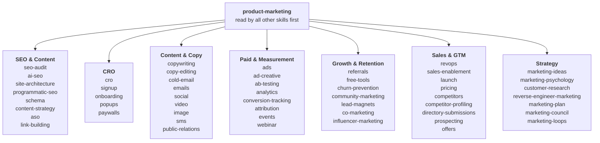
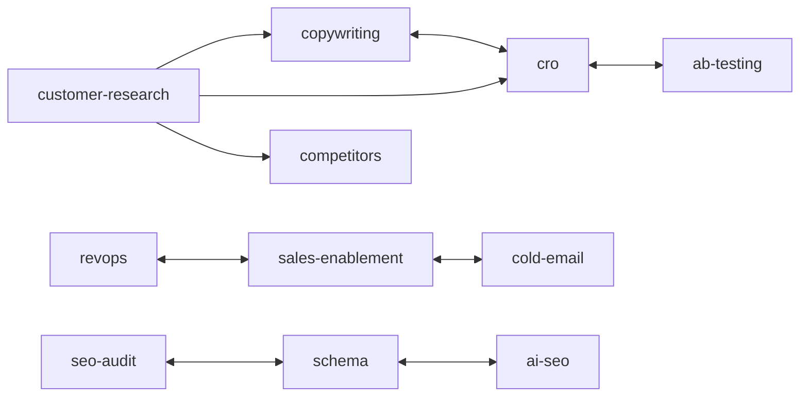

# REVConstruct Marketing Skills for AI Agents

A collection of AI agent skills focused on marketing tasks. Built for technical marketers and founders who want AI coding agents to help with conversion optimization, copywriting, SEO, analytics, and growth engineering. Works with Claude Code, OpenAI Codex, Cursor, Windsurf, and any agent that supports the [Agent Skills spec](https://agentskills.io).

Maintained by REVConstruct. Based on [Marketing Skills](https://github.com/coreyhaines31/marketingskills) by [Corey Haines](https://corey.co) (MIT). This is REVConstruct's fork of that library, forked at upstream 2.14.10. What we changed:

- **New and expanded skills:** a `webinar` skill, a Reddit reference in `community-marketing`, and updates to `ai-seo`, `ads`, `seo-audit`, `image`, `cold-email`, and others. The full list is in [VERSIONS.md](VERSIONS.md).
- **Fixes:** broken links, wrong cross-references, and out-of-date platform names.
- **Clear sourcing:** every outside source was checked for copied text, and the pack now credits it accurately; see [Credits](#credits). The copywriting transitions reference and the B2B ads lifecycle stages are rebuilt on public-domain and industry-standard frameworks, with text written for this pack.
- **No paid placement:** the upstream partner program and its sponsor markers are removed. Tools appear as neutral options alongside their alternatives.
- **Safety checks:** CI scans skills and tools for hidden content and dead links. See [SECURITY.md](SECURITY.md).
- **Its own install identity:** the plugin is `revconstruct-marketingskills` in the `revconstruct` marketplace. Skill names match upstream, so this pack replaces the original rather than running beside it.

REVConstruct is not affiliated with, sponsored by, or endorsed by Corey Haines or the original Marketing Skills project. "Marketing Skills" here describes what the pack does; it is not a claim to the original project's name. The skills are provided as is, without warranty of any kind; see [LICENSE](LICENSE). Material adapted from other sources keeps its own terms; see [THIRD_PARTY_NOTICES.md](THIRD_PARTY_NOTICES.md).

Want your agent to read your marketing accounts? Follow the [guided tool connection workflow](tools/SETUP.md) for scoped credentials and a first read-only result.

**Contributions welcome!** Found a way to improve a skill or have a new one to add? [Open a PR](#contributing).

Run into a problem or have a question? [Open an issue](https://github.com/rev-construct/marketingskills/issues) — we're happy to help.

## What are Skills?

Skills are markdown files that give AI agents specialized knowledge and workflows for specific tasks. When you add these to your project, your agent can recognize when you're working on a marketing task and apply the right frameworks and best practices.

### Skills, prompts, projects, MCP, or subagents?

| Use a... | When you need |
|----------|---------------|
| **Skill** | Reusable know-how an agent loads when the task matches (this repo) |
| **Prompt** | A one-off instruction for a single conversation |
| **Project** | Standing context and files shared across many chats |
| **MCP server / tool** | Live access to a system: your analytics, CRM, or ad account (see [tools/REGISTRY.md](tools/REGISTRY.md)) |
| **Subagent** | A separate worker with its own context, for a task you want run in parallel or isolated |

**Before installing:** skills are instructions your agent follows, and some point it at CLI tools or MCP servers. Read what you install and pin a release tag. See [SECURITY.md](SECURITY.md).

## How Skills Work Together

Skills reference each other and build on shared context. The `product-marketing` skill is the foundation — every other skill checks it first to understand your product, audience, and positioning before doing anything.



Skills also cross-reference each other. The main links:



See each skill's **Related Skills** section for the full dependency map.

## Available Skills

<!-- SKILLS:START -->
| Skill | Description |
|-------|-------------|
| [ab-testing](skills/ab-testing/) | When the user wants to plan, run, or read A/B tests, or asks a judgement call on one: is the result real, can we stop,... |
| [ad-creative](skills/ad-creative/) | When the user wants to write or judge ad creative, or asks which ad, hook, or angle to run or kill: headlines, primary... |
| [ads](skills/ads/) | When the user wants to plan, run, or fix paid ads on Google, Meta, and LinkedIn, or asks a judgement call on them: are... |
| [ai-seo](skills/ai-seo/) | When the user wants to get cited and recommended in AI answers (ChatGPT, Perplexity, AI Overviews), or asks why AI... |
| [analytics](skills/analytics/) | When the user wants to set up or audit analytics, or asks whether a metric or number is calculated right, what to... |
| [aso](skills/aso/) | When the user wants to audit or optimize an App Store or Google Play listing, or asks which title, keywords, or... |
| [attribution](skills/attribution/) | When the user wants to work out which marketing drives revenue, or asks whether a channel is really working, which... |
| [churn-prevention](skills/churn-prevention/) | When the user wants to reduce churn, or asks why customers cancel, whether to offer a discount or pause: cancellation... |
| [co-marketing](skills/co-marketing/) | When the user wants co-marketing partners or joint campaigns, or asks whether a partner fits, a size mismatch matters,... |
| [cold-email](skills/cold-email/) | When the user wants to write or run B2B cold outbound, or asks whether an opener, reason to reach out, or email works... |
| [community-marketing](skills/community-marketing/) | When the user wants to build or grow an online community, or asks whether a community is worth it, where to host it, or... |
| [competitor-profiling](skills/competitor-profiling/) | When the user wants to research competitors into dated profiles, or asks what a rival charges, claims, or is doing, or... |
| [competitors](skills/competitors/) | When the user wants to create or audit comparison and alternative pages ('X vs Y', 'X alternative', 'best X... |
| [content-strategy](skills/content-strategy/) | When the user wants to plan content, or asks which topic or piece to prioritize, what to write about, or why posts... |
| [conversion-tracking](skills/conversion-tracking/) | When the user wants to set up, audit, or fix conversion tracking to Google Ads, Meta, GA4, LinkedIn, and TikTok, or... |
| [copy-editing](skills/copy-editing/) | When the user wants to edit, tighten, proofread, or refresh existing copy, or asks whether to keep, cut, or change a... |
| [copywriting](skills/copywriting/) | When the user wants to write or rewrite page copy (homepage, landing, pricing, feature), or asks which headline,... |
| [cro](skills/cro/) | When the user wants more conversions from a page or form, or asks why a page isn't converting, what to change first, or... |
| [customer-research](skills/customer-research/) | When the user wants to run or synthesize customer research, or asks what customer quotes, reviews, or feedback really... |
| [directory-submissions](skills/directory-submissions/) | When the user wants to list a product in startup, SaaS, AI, MCP, and review directories, or asks which directories are... |
| [emails](skills/emails/) | When the user wants to create or improve automated email sequences, or asks what to send, when, or whether an email or... |
| [events](skills/events/) | When the user wants to plan, run, sponsor, or speak at events, or asks whether an event or booth is worth the money:... |
| [free-tools](skills/free-tools/) | When the user wants to plan or build a free tool as marketing, or asks whether a tool idea is worth building or which... |
| [image](skills/image/) | When the user wants to create, generate, edit, or optimize marketing images, or asks which approach to take (generate,... |
| [influencer-marketing](skills/influencer-marketing/) | When the user wants creator, influencer, or ambassador partnerships, or asks which creators fit, what to pay, which... |
| [launch](skills/launch/) | When the user wants to plan a product or feature launch, or asks whether it's ready, when to announce, or how to get... |
| [lead-magnets](skills/lead-magnets/) | When the user wants to plan or improve a lead magnet, or asks what to give away for emails or how much to ask in return... |
| [link-building](skills/link-building/) | When the user wants backlinks and mentions that lift rankings and AI citations, or asks how to get sites to link or... |
| [marketing-council](skills/marketing-council/) | When the user wants several expert takes on a marketing decision, or asks what a famous marketer would say about it: a... |
| [marketing-ideas](skills/marketing-ideas/) | When the user wants marketing ideas or growth tactics for a software product, or asks what to try to get attention or... |
| [marketing-loops](skills/marketing-loops/) | When the user wants a recurring marketing job an AI agent runs on a cadence or trigger, or asks what a weekly or daily... |
| [marketing-plan](skills/marketing-plan/) | Produces a full marketing or go-to-market plan. Use when the user wants one for a client, an advised company, or their... |
| [marketing-psychology](skills/marketing-psychology/) | When the user wants to apply psychology to marketing, or asks why buyers behave or value things as they do, or whether... |
| [offers](skills/offers/) | When the user wants to design or improve the offer itself, or asks why it isn't selling or how to add urgency honestly:... |
| [onboarding](skills/onboarding/) | When the user wants better onboarding and activation, or asks why new users don't stick or what the first session... |
| [paywalls](skills/paywalls/) | When the user wants to create or improve in-app paywalls and upgrade moments, or asks when or how hard to ask free... |
| [popups](skills/popups/) | When the user wants to create or improve popups, modals, slide-ins, sticky bars, and banners, or asks whether one will... |
| [pricing](skills/pricing/) | When the user wants to set pricing and packaging, or asks what to charge, whether to raise prices, or how to move... |
| [product-marketing](skills/product-marketing/) | When the user wants to create or update the product marketing context doc (.agents/product-marketing.md), or asks what... |
| [programmatic-seo](skills/programmatic-seo/) | When the user wants SEO pages at scale from templates and data, or asks whether a page set will rank or look thin:... |
| [prospecting](skills/prospecting/) | When the user wants to find and qualify prospects for outbound, or asks who to target first, which signal to... |
| [public-relations](skills/public-relations/) | When the user wants press and media coverage, or asks what to say to a reporter, whether a story is newsworthy, or how... |
| [referrals](skills/referrals/) | When the user wants referral and affiliate programs or word of mouth, or asks what to reward, how much to pay, or which... |
| [reverse-engineer-marketing](skills/reverse-engineer-marketing/) | When the user wants to know how another company grew and what to copy, or asks what a competitor did and when: a dated... |
| [revops](skills/revops/) | When the user wants to design revenue operations, or asks when a lead is ready for sales or why sales and marketing... |
| [sales-enablement](skills/sales-enablement/) | When the user wants sales collateral, or asks what to give a champion or rep, or how to answer an objection or make the... |
| [schema](skills/schema/) | When the user wants to add, fix, or validate schema markup (JSON-LD), or asks which type fits a page or whether some... |
| [seo-audit](skills/seo-audit/) | When the user wants to audit or diagnose SEO, or asks why traffic dropped, a page won't rank, or whether a setup like... |
| [signup](skills/signup/) | When the user wants better signup, registration, and trial start flows, or asks which fields or steps to cut or whether... |
| [site-architecture](skills/site-architecture/) | When the user wants to plan or restructure a website, or asks which pages they need or where something belongs:... |
| [sms](skills/sms/) | When the user wants SMS, MMS, or WhatsApp marketing, or asks whether texting is worth it or a message is allowed:... |
| [social](skills/social/) | Writes, schedules, and repurposes organic social posts. Use when the user wants content for LinkedIn, X, Instagram,... |
| [video](skills/video/) | When the user wants to create video with AI tools or code, or asks which approach to use (screen recording, AI avatar,... |
| [webinar](skills/webinar/) | When the user wants to plan, promote, or run a webinar or virtual event, or asks what topic to pick, how to structure... |
<!-- SKILLS:END -->

## Installation

> **Already have the original Marketing Skills installed?** This pack uses the same skill names (`cro`, `emails`, ...), so it replaces the original rather than running beside it. Remove the original first: delete its skill folders for `npx skills` installs, or run `/plugin uninstall marketing-skills@marketingskills` in Claude Code, or remove `marketing-skills` from `/plugins` in Codex.

### Option 1: CLI Install (Recommended)

Use [npx skills](https://github.com/vercel-labs/skills) to install skills directly:

```bash
# Install all skills
npx skills add rev-construct/marketingskills

# Install specific skills
npx skills add rev-construct/marketingskills --skill cro copywriting

# List available skills
npx skills add rev-construct/marketingskills --list
```

The CLI detects which agents you have installed and asks where to install. For Claude Code it installs into `.claude/skills/`; universal agents share `.agents/skills/`.

> [!TIP]
> If you run the command from **inside** an agent session (e.g., asking Claude Code to install the skills for you), the CLI runs non-interactively and may only install to the universal `.agents/skills/` directory, which Claude Code does not read. Pass the agent explicitly:
>
> ```bash
> npx skills add rev-construct/marketingskills -a claude-code
> ```

### Option 2: Claude Code Plugin

Install via Claude Code's built-in plugin system:

```bash
# Add the marketplace
/plugin marketplace add rev-construct/marketingskills

# Install all marketing skills
/plugin install revconstruct-marketingskills
```

> **Note:** `/plugin` is only available in an interactive Claude Code CLI session. It is **not** available in Claude Code on the web, GitHub Actions, or other non-interactive/remote environments — in those cases you'll see `/plugin isn't available in this environment`. Use **Option 1 (`npx skills`)** instead, or the equivalent CLI commands:
>
> ```bash
> claude plugin marketplace add rev-construct/marketingskills
> claude plugin install revconstruct-marketingskills@revconstruct
> ```

### Option 3: OpenAI Codex Plugin

Install via Codex's plugin system:

```bash
# Add the marketplace
codex plugin marketplace add rev-construct/marketingskills

# Then browse and install from inside a Codex session
/plugins
```

Select **revconstruct-marketingskills** to install all skills. To pick up new releases later, run `codex plugin marketplace upgrade`.

### Option 4: Clone and Copy

Clone the entire repo and copy the skills folder:

```bash
git clone https://github.com/rev-construct/marketingskills.git
cp -r marketingskills/skills/* .agents/skills/
```

### Option 5: Git Submodule

Add as a submodule for easy updates:

```bash
git submodule add https://github.com/rev-construct/marketingskills.git .agents/marketingskills
```

Then reference skills from `.agents/marketingskills/skills/`.

### Option 6: Fork and Customize

1. Fork this repository
2. Customize skills for your specific needs
3. Clone your fork into your projects

### Option 7: SkillKit (Multi-Agent)

Use [SkillKit](https://github.com/rohitg00/skillkit) to install skills across multiple AI agents (Claude Code, Cursor, Copilot, etc.):

```bash
# Install all skills
npx skillkit install rev-construct/marketingskills

# Install specific skills
npx skillkit install rev-construct/marketingskills --skill cro copywriting

# List available skills
npx skillkit install rev-construct/marketingskills --list
```

### Option 8: Claude Web Skill ZIPs

Download the desired `<name>-claude-web.zip` from [Releases](https://github.com/rev-construct/marketingskills/releases/latest), then use **Customize → Skills → + Create skill → Upload a skill** in Claude. Each archive contains one skill. Account permissions and code execution must allow skills.

The web-target archive uses an explicitly reviewed shorter description; its instructions and resources are preserved. The attached web manifest lists any skills whose description still needs review; newly created release notes also summarize omissions. Installing a ZIP does not configure local CLIs, MCP servers, credentials, or related skills. See [release packaging and verification](docs/skill-release-packaging.md) for archive contents, source variants, and unverified client limitations.

### Option 9: Perplexity Computer Skill ZIPs

Download the desired `<name>-perplexity.zip` from [Releases](https://github.com/rev-construct/marketingskills/releases/latest), then in Perplexity Computer use **Plugins → Add custom → Skill → Upload skill**. These archives keep the original skill files with `SKILL.md` at the root, which Perplexity requires; the source and Claude web ZIPs nest the skill in a folder and won't upload there. Installing a ZIP doesn't configure local CLIs, MCP servers, or related skills.

## Upgrading from v1.x to v2.0

v2.0 renames 17 skills and consolidates `page-cro` + `form-cro` into a single `cro` skill. If you installed the v1.x skills, you'll have **stale old-name folders** in your install directory after upgrading — the new skills install alongside the old ones, so you'll see both `skills/page-cro/` and `skills/cro/`, etc. Clean them up:

```bash
# From the directory where you installed the skills (e.g., .agents/skills/ or .claude/skills/)
rm -rf page-cro form-cro \
       ab-test-setup analytics-tracking aso-audit competitor-alternatives \
       email-sequence free-tool-strategy launch-strategy onboarding-cro \
       paid-ads paywall-upgrade-cro popup-cro pricing-strategy \
       product-marketing-context referral-program schema-markup \
       signup-flow-cro social-content
```

Then reinstall the v2.0 skills via your usual method (e.g., `npx skills add rev-construct/marketingskills`).

### Migrate the product marketing context file

In v2.0 the context file moved from `.claude/` to `.agents/` and was renamed from `product-marketing-context.md` to `product-marketing.md`. Move your existing context file:

```bash
mkdir -p .agents
# v2.0 file (or pre-v2.0 file with new name)
mv .claude/product-marketing.md .agents/product-marketing.md 2>/dev/null
# pre-v2.0 file with legacy name
mv .claude/product-marketing-context.md .agents/product-marketing.md 2>/dev/null
```

Skills will still check `.claude/` and the legacy `product-marketing-context.md` filename as fallbacks, so nothing breaks if you don't migrate.

### Full rename map

| Old | New |
|-----|-----|
| `ab-test-setup` | `ab-testing` |
| `analytics-tracking` | `analytics` |
| `aso-audit` | `aso` |
| `competitor-alternatives` | `competitors` |
| `email-sequence` | `emails` |
| `form-cro` | merged into `cro` |
| `free-tool-strategy` | `free-tools` |
| `launch-strategy` | `launch` |
| `onboarding-cro` | `onboarding` |
| `page-cro` | `cro` |
| `paid-ads` | `ads` |
| `paywall-upgrade-cro` | `paywalls` |
| `popup-cro` | `popups` |
| `pricing-strategy` | `pricing` |
| `product-marketing-context` | `product-marketing` |
| `referral-program` | `referrals` |
| `schema-markup` | `schema` |
| `signup-flow-cro` | `signup` |
| `social-content` | `social` |

## Usage

Once installed, just ask your agent to help with marketing tasks:

```
"Help me optimize this landing page for conversions"
→ Uses cro skill

"Write homepage copy for my SaaS"
→ Uses copywriting skill

"Set up GA4 tracking for signups"
→ Uses analytics skill

"Create a 5-email welcome sequence"
→ Uses emails skill
```

You can also invoke skills directly:

```
/cro
/emails
/seo-audit
```

## Skill Categories

### Conversion Optimization
- `cro` - Pages and forms
- `signup` - Registration flows
- `onboarding` - Post-signup activation
- `popups` - Modals and overlays
- `paywalls` - In-app upgrade moments

### Content & Copy
- `copywriting` - Marketing page copy
- `copy-editing` - Edit and polish existing copy
- `cold-email` - B2B cold outreach emails and sequences
- `emails` - Automated email flows
- `social` - Social media content
- `image` - AI image generation, design tools, and optimization

### SEO & Discovery
- `seo-audit` - Technical and on-page SEO
- `ai-seo` - AI search optimization (AEO, GEO, LLMO)
- `link-building` - Earned links and mentions on AI-cited pages
- `programmatic-seo` - Scaled page generation
- `site-architecture` - Page hierarchy, navigation, URL structure
- `competitors` - Comparison and alternative pages
- `schema` - Structured data

### Paid & Distribution
- `ads` - Google, Meta, LinkedIn ad campaigns
- `events` - Webinars, conferences, sponsorships, speaking
- `webinar` - Plan, promote, and run webinars and virtual events
- `ad-creative` - Bulk ad creative generation and iteration
- `social` - Social media scheduling and strategy

### Measurement & Testing
- `analytics` - Event tracking setup
- `conversion-tracking` - Pixels, conversion tags, server-side delivery, and tracking audits
- `ab-testing` - Experiment design

### Retention
- `churn-prevention` - Cancel flows, save offers, dunning, payment recovery

### Growth Engineering
- `co-marketing` - Partner identification and joint campaigns
- `free-tools` - Marketing tools and calculators
- `referrals` - Referral and affiliate programs

### Strategy & Monetization
- `marketing-ideas` - 140 SaaS marketing ideas
- `marketing-psychology` - Mental models and psychology
- `launch` - Product launches and announcements
- `pricing` - Pricing, packaging, and monetization
- `reverse-engineer-marketing` - Growth teardowns of any company, with plays to copy

### Sales & RevOps
- `revops` - Lead lifecycle, scoring, routing, pipeline management
- `sales-enablement` - Sales decks, one-pagers, objection docs, demo scripts

## Contributing

Found a way to improve a skill? Have a new skill to suggest? PRs and issues welcome!

See [CONTRIBUTING.md](CONTRIBUTING.md) for guidelines on adding or improving skills.

## Credits

This pack builds on [Marketing Skills](https://github.com/coreyhaines31/marketingskills) by Corey Haines (MIT). Outside material falls into four groups; [THIRD_PARTY_NOTICES.md](THIRD_PARTY_NOTICES.md) has every source, the files that use it, and the results of a text-overlap check against each public source (2026-11-12).

- **Included under the MIT License, with notices:** detection snippets and GTM recipes from the [ConversionKit conversion-tracking toolkit](https://github.com/ConversionKit/conversion-tracking) (Converly), podcast prep from [ai-visibility-skills](https://github.com/Knowatoa/ai-visibility-skills) (Knowatoa), and two prospecting references from Kappaemme's [local-client-prospector](https://github.com/Kappaemme-git/local-client-prospector-skill) and [first-customer-finder](https://github.com/Kappaemme-git/codex-first-customer-finder-skill). Each file carries its source's copyright line.
- **Public domain:** the transition types in the federal plain language guidelines ([plainlanguage.gov](https://www.plainlanguage.gov/guidelines/organize/use-transition-words/)).
- **Re-expressed from MIT-licensed work:** Profound and Wispr Flow skills ([skills-marketing-library](https://github.com/retieedra-profound/skills-marketing-library)) and eliasstravik's [gtm-skills](https://github.com/eliasstravik/gtm-skills).
- **Inspired by:** Ivan Falco's [ads-skills](https://github.com/ivangfalco/ads-skills), Prof. John Dawes's 95:5 rule (Ehrenberg-Bass Institute with LinkedIn's B2B Institute), Eugene Schwartz's awareness levels, and the practitioners named in each skill's lineage notes. No text from these sources is included.

## License

[MIT](LICENSE) - Use these however you want.
